<!-- _class: title -->
<!-- _paginate: false -->

# Learning to Fly Freestyle

## An automatic aerobatic display on a quad

Dr Andy Piper

---

<!-- _paginate: false -->
<!-- _footer: "" -->

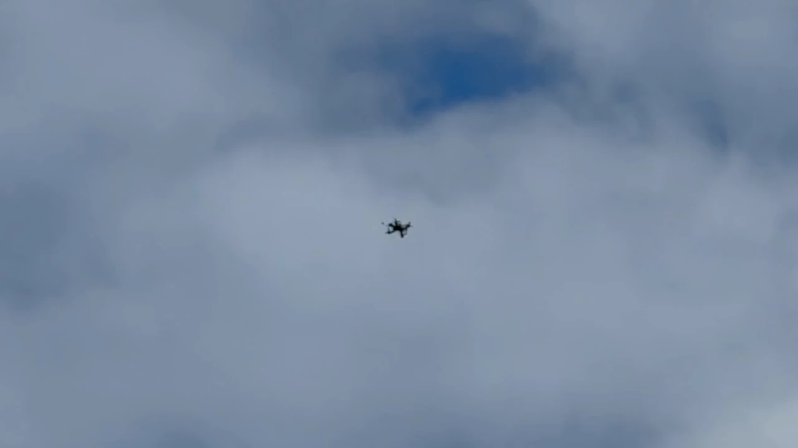

---

## Andy Piper and FOSS UAV

### Dr Andy Piper

- PhD, Cambridge
- BEA, Oracle, then startups
- ArduPilot since 2015
- CRSF, DShot, harmonic notch, fast rates

fossuav.com

- SmallFastDrone: ArduCopter, small and fast
- 40+ features, 14 merged upstream
- ArduPilot AI Playbooks
- Development, tuning, log analysis

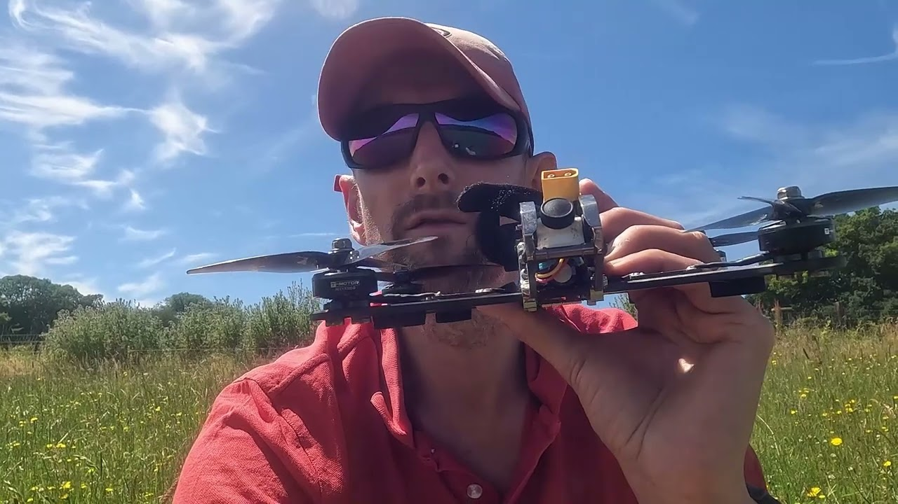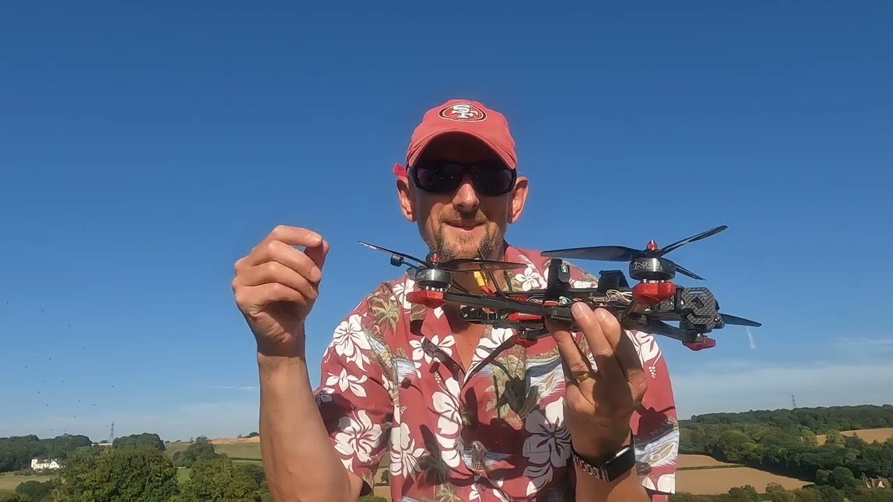

---

## Freestyle

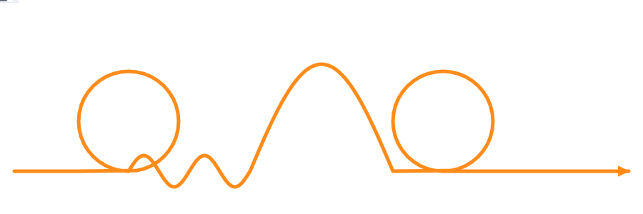

- Loops, flips, rolls, snaps
- One into the next, no pauses
- Float: hang time over the top

- Judged on flow, consistency, creativity
- A pilot does it by feel

Judging criteria: MultiGP freestyle. Can a script fly by feel?

---

## Last year, this year

### 2025

- Flip on a switch
- One figure
- One Lua applet

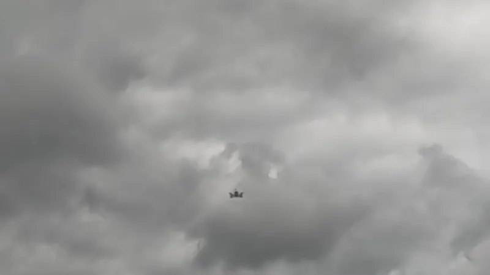

Half speed, ground camera.

### 2026

- Ten figures, ten lines
- Two minutes on a line
- Hands the aircraft back

---

## The show

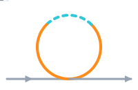1. Float loop

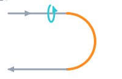6. Split-S

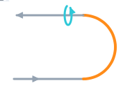2. Immelmann

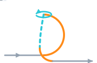7. Loop-spin

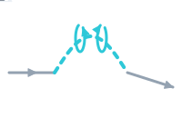3. Juicy flick

8. Immelmann

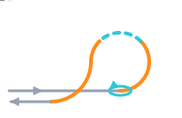4. Pivot loop

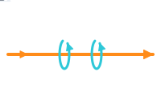9. Drill

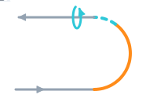5. Float immelmann

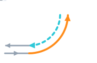10. Rewind

* Hard for a human pilot

Side view. Grey arrows: direction of travel. Dashed: ballistic. Cyan ring round the path: a roll; flat ring: a yaw.

---

## Three questions

1. How should the aircraft move?
2. How do we fly that motion?
3. What went wrong, and how do we fix it?

RealFlight flies it live in the middle. The Marmott flies it this afternoon.

---

<!-- _class: section -->

# How should the aircraft move?

## Entry speed, the float over the top, and attitude

---

## Fly it like a thrown ball

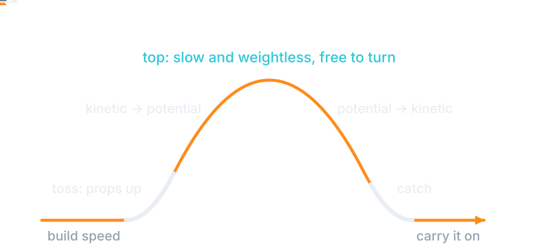

- Thrust builds speed: kinetic energy
- The climb trades it for height

- Rotate at the top, where it's free
- Carry the speed into the next

---

## Entry speed: a perfect loop needs 6 g

$$
\underbrace{\frac{v_{top}^2}{r} = g}_{\text{top: gravity turns it}}
\qquad
\underbrace{v_{bot}^2 = v_{top}^2 + 4 g r = 5 g r}_{\text{falling } 2r}
\qquad
\underbrace{n = 1 + \frac{v_{bot}^2}{g r} = 6}_{\text{bottom: weight + turn}}
$$

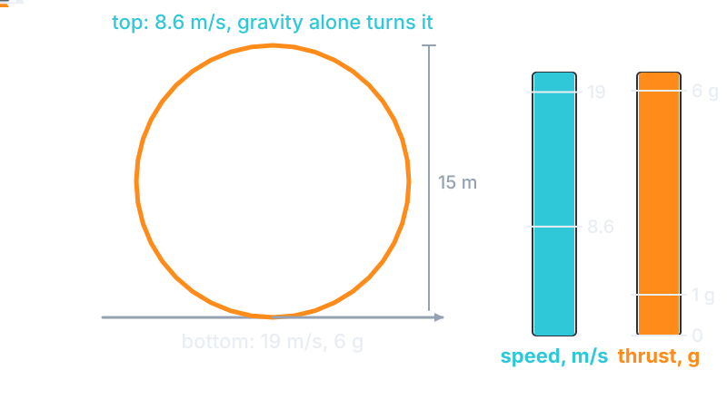

- Thrust turns it: $v^2/r$
- Bigger: gentler, so faster
- Same 6 g, any size or mass
- Faster: more g, to the limit

A perfect loop: a true circle, no drag, the slowest top. 15 m, at its own pace.

---

## The float: round costs g, ballistic costs shape

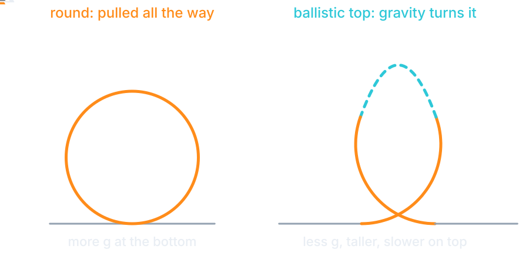

- Round: keeps its speed over the top

- Ballistic: spends it on height

---

## Attitude: a quad has no wing

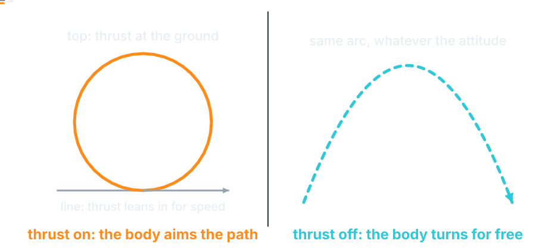

- Only thrust and gravity turn the path

- Thrust points where the body points

---

<!-- _class: section -->

# How do we fly that motion?

## Replay a pilot, position control all the way, or split it

---

## Why not replay a pilot?

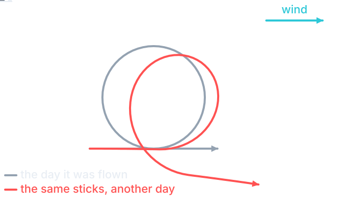

- Stick inputs fit one battery, wind, airframe

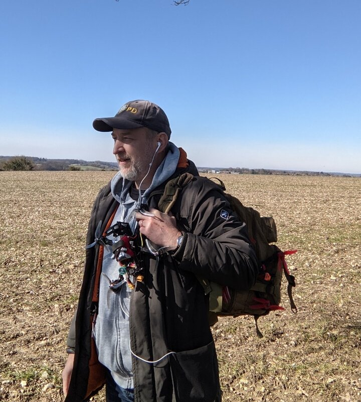

- The pilot's moves are the reference
- Sim and aircraft checked against them
- Shapes, rates and timing to match

Schematic. The pilot's profile is a feed-forward inside the loop, never an open-loop replay.

---

## Why not position control all the way round?

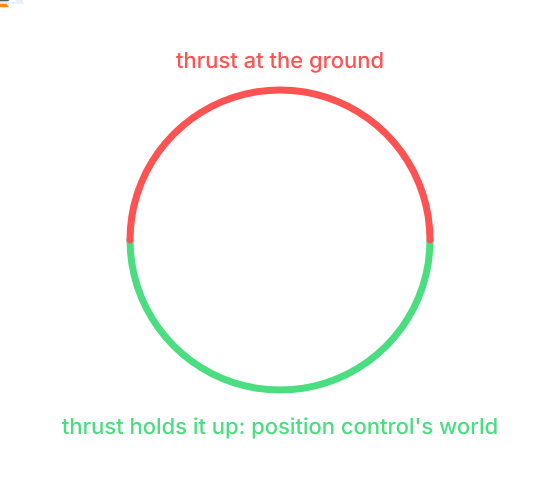

- All of it flies in Guided
- Position targets: run-ins, lines, recoveries
- The position controller knows the limits
- It assumes thrust holds you up

* ...or can it?

* <strong>It can. The PR goes up now, live.</strong>Thrust past 90 deg, vertical arc waypoints. `PSC_TVEC_EN`, off by default.

---

## Rate and thrust, with angle boost off

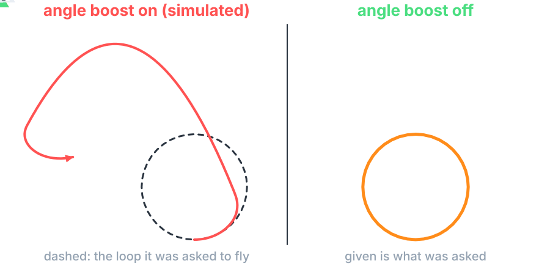

- The script sends body rate and thrust
- Every thrust a g-load, measured in flight

- Boost on, the first loop climbed 32 m
- Angle boost off: the g asked is given

Half speed; the left is simulated. Dashed arrow: asked. Solid: given.

---

## The split

All of it is Guided: the script picks the command each segment trusts.


A mode change is the kill switch.

---

## Testing

* Static: Lua benches and log analysis105 scriptsthe maths and every flight, checked offline
* Native SITL32 teststhe Rise255 model, the autotest suite
* RealFlight17 teststhe same autotest, a virtual joystick
* The Marmottthe only witnessa field card per session

Cheapest first; each rung catches what the one above cannot.

---

## Testing in RealFlight

### What it's for

- 45 displays in an afternoon
- Spread: +-7.4 m to +-1.5 m
- Does the show hold together

### Watch for its limits

- Drag: 0.40-0.45 g vs 0.30
- Idle: 0.83 g vs ~0.2
- Lua at 97 Hz vs 24.5
- The shape of an arc

For a month both sims flew renamed parameters: dropped silently from a defaults file.

Each pair: RealFlight, then the Marmott.

---

<!-- _class: section -->

# Live: RealFlight

## `RealFlightShowFenceStartOffset`

---

<!-- _class: section -->

# What went wrong, and how do we fix it?

## When physical reality intervenes

---

## Problem 1: 19 July, the drag we didn't size for


`AUTA_LP_DRAG` is not a drag estimate. It is the safety factor.

Schematic, numbers from the log. Sized on 0.30 g of drag; it met 0.65.

---

## Rule 1: always finish the figure


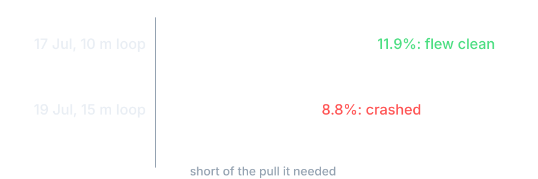

- Refuse only at the start, on height
- Once started, give up the circle
- Rotation is free: finish on it

A check before the figure can't see inside it: the loop that flew was further short than the one that crashed.

---

## Problem 2: the twitch between figures

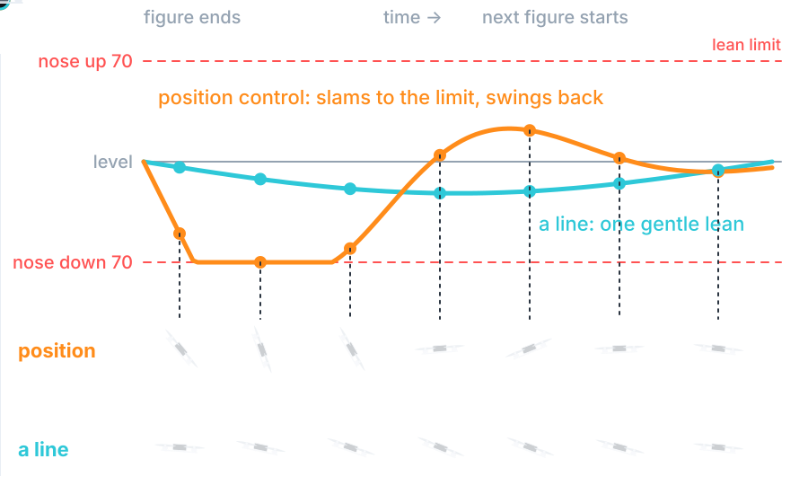

- The next figure wants a new speed
- Position control goes as hard as `WP_ACC` allows
- The quad slams to its lean limit, then swings back

Rule 2: turn the position controller down between figures.

Schematic. Fix: each line lowers `WP_ACC` and `PSC_JERK_NE` for its span.

---

## Problem 3: handing over still rotating

Thrust is how a quad climbs, brakes and accelerates, and it points where the body points.

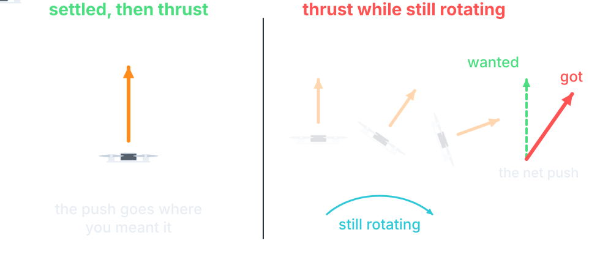

Rule 3: don't correct at the wrong moment. Brake the rotation, then thrust.

Twelve instances. Immelmann: 764 dps, 142 deg past upright. Loop-spin: 182 dps, 36 deg past level.

---

## Problem 4: the wind

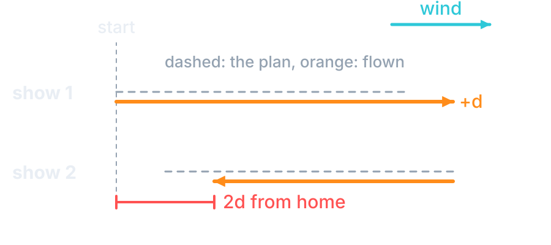

- Figures fly the air, lines the ground
- A mirrored repeat doubles the drift
- Placement centres the box, can't shrink it
- The fence knows nothing of wind

`EK3_DRAG_MCOEF` = 0.22: EKF3 estimates wind only by drag fusion; fitted off the Marmott's own logs

Rule 4: don't chase the wind on the lines. Paying it back grew the box 60-110 m (RealFlight).

26 Sep: 76 m from its mirror in 1-2 m/s along. 28 Sep: 34 m off the line in 3-4 m/s across.

---

## Building it with Claude Code


- Every session reads all of it first
- Rules promoted only once proven

- 56 dead ideas, killed by measurement
- Offline, SITL, RealFlight, then fly

---

## Problem 5: a convincing wrong answer

Claude: the sideways speed handed over causes the drift

* **Correlation:** more sideways speed, more drift, r = +0.86 TRUE
* **Control:** two identical immelmanns, 11.6 m against 6.1 m, 4 runs of 4 TRUE
* **Mechanism:** a line of code commands them differently TRUE

* 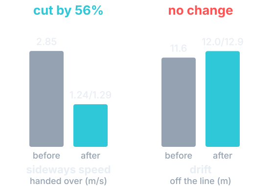

* WRONG

RealFlight, 2 Sep. Every fact was true; the conclusion was not.

Rule 5: measure every time it explains. Two runs, four mechanisms dead in one day.

---

## The rules

| Problem | Rule |
|---|---|
| 1. The drag we didn't size for | Always finish the figure |
| 2. The twitch between figures | Turn position control down between figures |
| 3. Handing over still rotating | Brake the rotation, then thrust |
| 4. The wind | Don't chase it on the lines |
| 5. A convincing wrong answer | Measure every time it explains |

---

## What the branch needed

set_target_rate_and_throttle(..., use_angle_boost)
set_target_angle_and_rate_and_throttle(..., use_angle_boost)
set_target_rate_and_climbrate(...)
AC_Fence polygon build bindings

Master has the first two, always with angle boost, which cuts the thrust to zero inverted.

The ask: rate and angle commands with angle boost off, so a script can fly inverted.

---

## Why it's safe to stand near


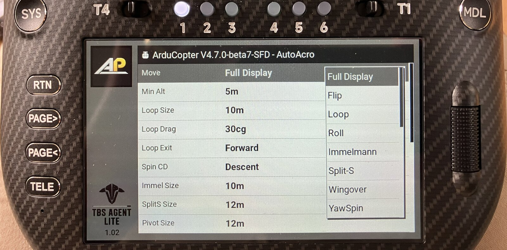

- Fenced, report only, while it flies
- Every figure height-gated first
- A mode change hands it back

- A local pilot on one switch
- Moves, sizes, floor: all from the radio

Wind is the limit. The Marmott has only left the line in 3 m/s or more across. Line down the wind; over 2 m/s across, no show.

<!-- Go/no-go: lay the line down the wind on the day. Over 2 m/s across, no show. FENCE_ACTION 0, report only, agreed with the site; the pilot's mode change is what acts. -->

---

## What you learned

### How should it move?

- Entry speed sizes the figure
- Gravity turns the top
- Thrust goes where the body points

### How do we fly it?

- Position control on the lines
- Rate and thrust in the figures
- Angle boost off to go inverted

### What went wrong?

- Always finish the figure
- Brake the rotation, then thrust
- Measure every time it explains

---

<!-- _class: title -->

# This afternoon

## Area X.O, Saturday pm

---

<!-- _class: title -->
<!-- _paginate: false -->

# Questions

---

<!-- _class: section -->

# Backup

## For questions: the full maths, the handovers, the tooling

---

## A loop is an energy budget

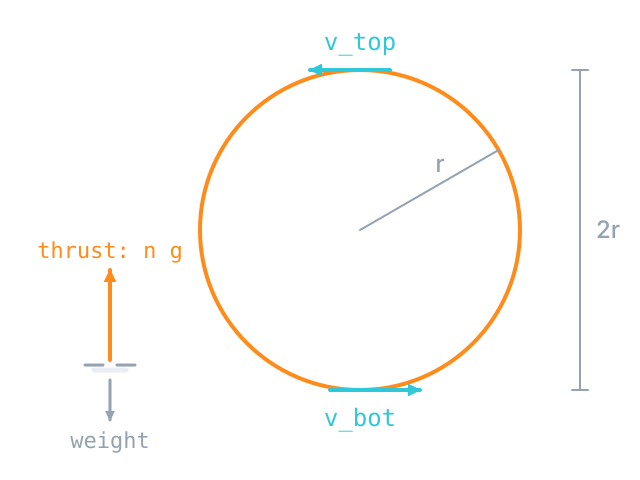

### Assumptions

- A point mass on a circle
- Thrust along the body, body on the path
- Drag: a constant $d$ g along the path
- At the top, gravity alone turns it

---

## The sizing law: size = $2r$

$$
\begin{aligned}
\text{top:}\quad & v_{top}^2 = m^2\, g\, r \\[4pt]
\text{climb } 2r\text{:}\quad & v_{bot}^2 = v_{top}^2 + 4\, g\, r + 2\pi d\, g\, r \\[4pt]
\text{bottom:}\quad & n_{bot} = 1 + \frac{v_{bot}^2}{g\, r} = m^2 + 5 + 2\pi d \\[4pt]
\text{rate:}\quad & \omega_{bot} = \frac{v_{bot}}{r}
\end{aligned}
$$

- $m$ is the top-speed multiplier; $m = 1$ means gravity alone turns the top
- $d$ = `AUTA_LP_DRAG` = 0.2 gives $n_{bot}$ = 7.3 g
- Checked: $v_{top}$ 5.81 m/s predicted, 5.85 flown

Not modelled: idle thrust at the top (0.17-0.22 g) pinches it; real drag grows with speed.

---

## Drag was the finding

$$
v_{bot}^2 = g\,r\,(5 + 2\pi d) \qquad d = 0.3:\ \ 2\pi d = 1.9
$$

- Drag is over a quarter of the entry energy
- Leave it out: the loop reaches the top slow
- Slow at the top, it falls through itself
- That is the 19 July crash

`AUTA_LP_DRAG` is not a drag estimate. It is the safety factor.

10 Jul: first loop, no drag term. 11 Jul: a budget, measured level. 19 Jul: read 0.65 g, sized on 0.30. Same speed and airframe reads 0.47 to 0.65 g.

---

## A bigger figure costs sky, not g

| Immelmann size | 8 m | 12 m |
|---|---|---|
| Bottom pull | same | same |
| Arc climb | 6.3-7.3 m | 10.0-10.5 m |
| Pitch rate | 235 dps | 192 dps |
| Its leg of the box | +19 to +27 m | +51 m |

Marmott, 2026-09-21. Floor 8 m: smaller cannot be sized. Ceiling ~15 m: the run-up cannot build the speed.

---

## Angle boost: right for hover, wrong for figures

$$
T_{out} = T_{in} \cdot \frac{\mathrm{clamp}(10\cos\theta,\ 0,\ 1)}{\max(\cos\theta_{target},\ 0.1)}
$$

### What it's for

- Tilting loses vertical thrust
- Divide by $\cos\theta$ to hold height
- Fades from ~84 deg, zero past 90

### Why it's off here

- In a figure, thrust is the control
- The g asked must be the g given
- It removes thrust inverted, where loops pull

`AC_AttitudeControl_Multi::get_throttle_boosted`. Off: every thrust is a g-load, $g_0 + k \cdot$ throttle, measured in flight.

---

## Zero throttle is not zero thrust

- The mixer lifts the average for authority
- 0.44-0.52 g at zero, while rotating
- So "ballistic" still carries thrust
- An upright cut arrests at ~0.5 g, not 1

`MOT_SPIN_MIN` at the bottom of the thrust curve
Above it, every "zero thrust" segment carries thrust

Marmott. Idle alone is 0.17-0.22 g; RealFlight's is 0.83 g.

---

## Where segments hand over

| Handover | What went wrong | Fix |
|---|---|---|
| Line to line | `WP_ACC` pegged: the twitch | Lines deliver the next entry speed |
| Arc to apex | Half-roll handed over at 764 dps | Brake to an attitude, then hand over |
| Fall to hover | Recover aimed low: 3.6 m under the start | Aim at the height the figure meant |

Clean when speed and load are continuous across it.

---

## What the pilot did give us

- Reference moves: log271, and Steve on the Marmott
- Sim and aircraft checked against the same log
- Shapes, rates and timing to match

Caught: our knife edge, tuned in RealFlight, was a wingover. It fell 4 m where the pilot's falls 12.6, because his bank is a schedule (86, 68, 20 deg), not a hold.

The pilot's profile is a feed-forward inside the loop, never an open-loop replay.

---

## Four rungs of testing

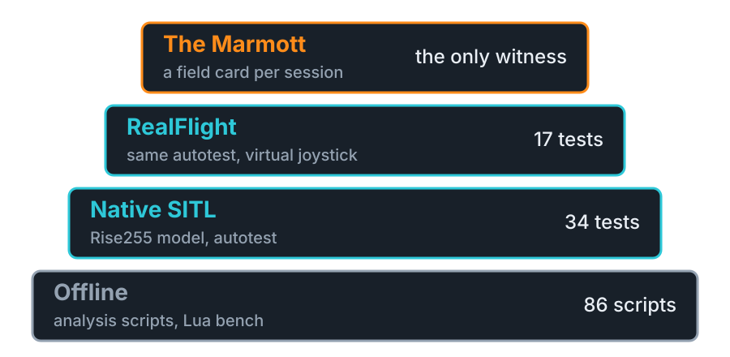

---

## Test a move from the transmitter

- Pick any of 19 moves
- Resize it between runs: 8-30 m
- Set the height floor
- Flip Scripting1 to fly it
- No laptop in the field

---

## Living inside the scripting engine

- 500 KB of heap for every script
- Split moves by show, not family
- Compile on the idle path, not load
- Lua's 100-local limit: 101 fails silently
- 24.5 Hz on the aircraft: 29 deg per tick at 700 dps

Load order was worth more than bytes: one moved require took the peak 500k to 475-485k.

---

## Rules it earned

- A figure is never energy-limited; only its radius is
- A move is handed the speed it wants
- A handover gate is guilty until measured
- The display is bimodal: one run proves nothing
- Do not tune the loop against RealFlight

---

## Do not resurrect: 56 dead ideas

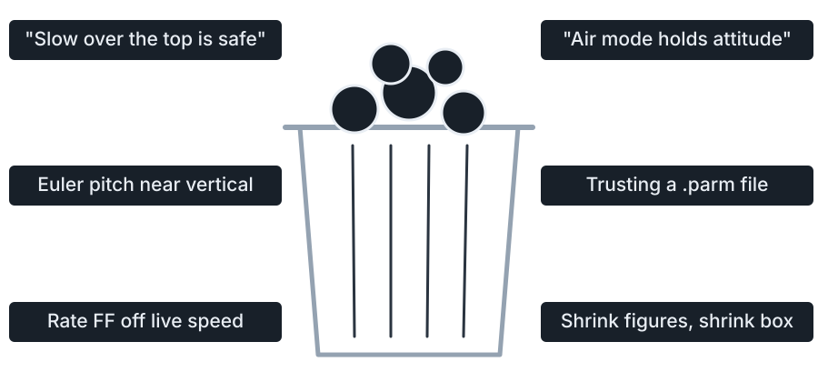

Each was flown, believed, and killed by measurement. Several were re-invented twice.
